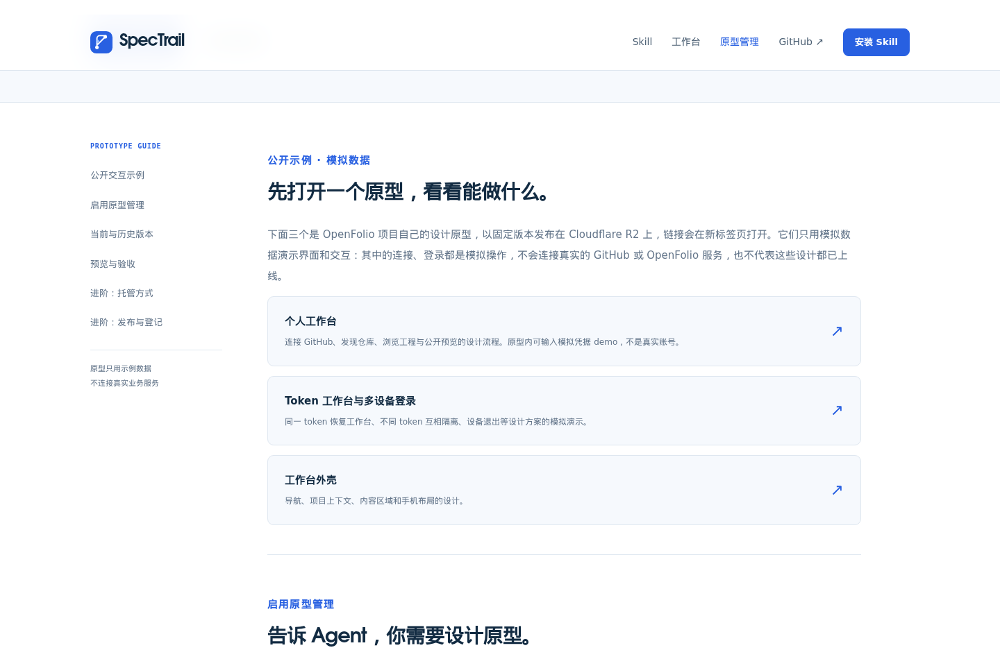

# 内容与首次使用评审

独立内容改写和复审由用户指定的本机 `iclaude` 完成：完整改写会话成功返回，69 轮、无权限拒绝，覆盖四页及导航、按钮、SEO、示例说明和复制反馈；第二个独立会话完成全文复审，提出 17 处必要修订；安装调查后的窄范围会话给出官网和 README 说明。项目 Agent 对照实际代码核对事实，并落实交互与可读性修正。

[iclaude 复审原文](iclaude-review.md) 保留当时的有条件结论；下列实际处理和验证补足其条件与安装疑点。

## 1. 首页：判断是否适用

状态：入口和模块分工清楚。首屏说明适用 Codex / Claude Code 用户、装在项目仓库里、先对齐目标再实现并留下记录；模块卡说明用途和使用时机，Skill 为默认入口，工作台和原型为可选。

## 2. Skill：安装、接入、第一条任务

状态：阅读与复制路径验证通过。三个步骤标明终端或 Agent 对话，解释操作之后会发生什么和用户需要做什么；Change 用“一次改动”解释，目录和规模细节位于进阶部分。自然语言提示词适用于两个客户端，并提供 Claude Code 显式调用示例和[官方 Skills 文档](https://code.claude.com/docs/en/skills)。

## 3. 工作台：获得实例并连接

状态：入口前提准确。主按钮指向获取实例地址与连接步骤；已有实例的用户向维护者获取地址，部署摘要收在进阶折叠区。有确证的手动仓库检查和阅读链接恢复说明已保留。

## 4. 原型：先体验再启用

状态：示例和启用路径清楚。交互示例位于正文前部，说明模拟数据和设计版本；版本管理及托管细节在其后。三个 R2 链接实际返回 200，个人工作台原型的 `demo` 模拟连接会关闭对话框并显示连接提示；没有把该原型当作真实服务登录验收。

## 问题与复验

| 编号 | 证据与影响 | 实际修正与复验 |
| --- | --- | --- |
| R-01 | 原页面在解释用途之前堆叠文件名、流程术语与三个模块；首次访问者缺少选择依据 | iclaude 重写四页和共用文案，以用途、时机和下一步组织；项目 Agent 对照当前捕获逐页检查 |
| R-02 | Skill 接入与首次任务段包含大量内部步骤；用户难以辨认自己要做的事 | 应用第二轮 17 处修订，将五段流程压缩为必要动作，保留实际确认、人工验收与合入选择 |
| R-03 | 原工作台主按钮跳向需要私有源码的部署命令，缺少实例前提 | 改为获取入口并连接；部署摘要可用键盘打开，命令复制与失败降级均通过 |
| R-04 | 首轮使用的缓存 OpenFolio README 是旧邀请码版本，造成能力疑点 | 核对当前已提交个人 token 分支 `3865d35` 的 README：只读 token、组织批准/SSO、手动 HTTPS 地址检查和跨用户阅读位置恢复均有依据；不恢复旧“多个连接”描述。没有修改 OpenFolio 工作区 |
| R-05 | 独立审阅指出安装环境混用 Node 20 与 24，未计入安装器要求 | skills@1.7.1 的实际 engines 为 Node >=22.20.0，统一推荐完整上手环境 Node 24+；状态脚本自身 Node 20+ 的事实仍保留在分发文档中 |
| R-06 | 实际 Claude Code 单客户端安装只生成 `.claude/skills/spec-trail/`，无法满足现有 `.agents/skills/spec-trail/` 脚本路径 | 安装命令改为 `--agent universal claude-code --copy -y`，同步 README 和网站生成器；临时 Git 仓库实测两个入口都生成，配置 workflow 后 setup readiness 为 ready。说明文字由 iclaude 组织 |
| R-07 | 通用复制反馈未说明去处，失败提示依赖桌面快捷键 | 命令与提示词分别提示终端或 Agent 对话；降级文本说明手机长按与桌面复制。三个提示词、安装命令、折叠部署命令与失败分支均通过浏览器检查 |
| R-08 | 首页安装区重复状态节点产生空白，站内链接统一使用外链箭头，手机示例文字偏小 | 删除重复节点，区分站内/站外箭头，手机示例辅助文字提高到 11px；20 个宽度检查均无横向溢出 |
| R-09 | 首轮报告读取了此前发布留下的两张 production 截图，其捕获不属于本轮 | 本报告仅使用本轮新捕获并实际查看的截图；旧 production 图片不作为本次结论的截图证据。复审已明确这一限制 |

## 证据与限制

[浏览器验证记录](evidence/browser-verification.json)、[首次使用交互记录](evidence/onboarding-verification.json)、[安装矩阵](evidence/installation-check.json)、[Claude Code 安装纠正](evidence/claude-install-correction.json) 与截图一同保存。

实际检查覆盖四页 × 320/390/768/1024/1440，模块切换、双客户端安装命令、复制成功与拒绝降级、手机导航与 Escape 焦点恢复、FAQ 键盘、无 JS 阅读、reduced motion、子路径资源，以及新增加的部署折叠区。没有使用真实 GitHub token 连接工作台，也没有把模拟原型、截图或临时安装解释为真实新用户完成完整项目交付；不声称完全无障碍合规。
